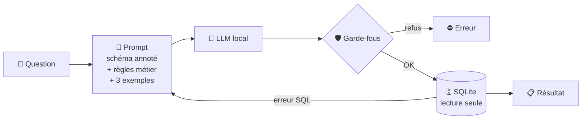

<div align="center">


# Text-to-SQL médicaments

**Posez une question en français, un LLM local la traduit en SQL sur la Base de données publique des médicaments.**
**Chaque modèle est mesuré sur un jeu de 60 questions de référence.**

[](https://github.com/GracielaTHOO/TEXT_TO_SQL4DRUGS/actions/workflows/ci.yml)
[](https://github.com/GracielaTHOO/TEXT_TO_SQL4DRUGS/actions/workflows/eval.yml)


[](https://huggingface.co/spaces/GracielaTHOO/text2sql-medicaments)
[](https://gracielathoo.github.io/TEXT_TO_SQL4DRUGS/)

</div>

---

```text
$ medsql ask "Quelles substances actives sont le plus souvent en rupture ou en tension ?"

SELECT c.substance, COUNT(DISTINCT d.cis) AS nb_specialites
FROM disponibilites d
JOIN compositions c ON c.cis = d.cis
WHERE d.code_statut IN (1, 2) AND c.nature_composant = 'SA'
GROUP BY c.substance
ORDER BY nb_specialites DESC
LIMIT 10
```

## 🎯 En bref

| | |
|---|---|
| 📦 **Données** | Les 11 fichiers open data de la [BDPM](https://base-donnees-publique.medicaments.gouv.fr/telechargement) (ANSM, HAS, Assurance maladie), normalisés en 12 tables SQLite documentées |
| 🧠 **Modèles** | LLM locaux servis par [Ollama](https://ollama.com) ou toute API compatible OpenAI ([vLLM](https://docs.vllm.ai), llama.cpp) |
| 🧪 **Évaluation** | 60 questions en français, 3 niveaux, 10 catégories, exactitude mesurée par exécution |
| 🛡️ **Sécurité** | SQL en lecture seule garanti par trois barrières indépendantes |
| 🖥️ **Interfaces** | CLI `medsql`, démo Gradio sur Hugging Face Spaces, tableau de bord HTML |
| ✅ **Qualité** | 146 tests, mypy strict, ruff, CI sur Python 3.10 à 3.13 |

## 📊 Résultats

<!-- RESULTS:START -->
| Modèle | Exactitude | Exactitude stricte | SQL exécutable | Latence p50 | Latence p95 | Date |
|---|---:|---:|---:|---:|---:|---|
| qwen2.5-coder:7b | **68,3 %** | 55,0 % | 100,0 % | 16,6 s | 35,0 s | 2026-10-14 |
| qwen2.5-coder:7b · sans libellés exacts | **63,3 %** | 51,7 % | 100,0 % | 14,7 s | 36,9 s | 2026-10-14 |
| qwen2.5-coder:7b · zero-shot · sans libellés exacts | **63,3 %** | 50,0 % | 100,0 % | 14,0 s | 24,9 s | 2026-10-14 |
| qwen2.5-coder:7b · sans auto-correction · sans libellés exacts | **61,7 %** | 50,0 % | 95,0 % | 15,2 s | 27,3 s | 2026-10-14 |
| qwen2.5-coder:3b | **60,0 %** | 43,3 % | 93,3 % | 7,5 s | 26,6 s | 2026-10-16 |
| qwen2.5-coder:1.5b | **58,3 %** | 38,3 % | 91,7 % | 3,9 s | 13,1 s | 2026-10-14 |
| qwen2.5-coder:3b · sans libellés exacts | **56,7 %** | 41,7 % | 91,7 % | 7,4 s | 25,2 s | 2026-10-12 |
| qwen2.5-coder:1.5b · sans libellés exacts | **55,0 %** | 33,3 % | 95,0 % | 3,8 s | 11,1 s | 2026-10-14 |
| qwen2.5-coder:1.5b · sans auto-correction · sans libellés exacts | **51,7 %** | 33,3 % | 88,3 % | 3,6 s | 5,8 s | 2026-10-14 |
| qwen2.5-coder:1.5b · zero-shot · sans libellés exacts | **48,3 %** | 41,7 % | 91,7 % | 3,4 s | 8,6 s | 2026-10-14 |

_60 questions · exactitude = résultat d'exécution identique à la référence (voir [docs/evaluation.md](docs/evaluation.md))._
<!-- RESULTS:END -->

Ce tableau est régénéré par `medsql report` à chaque évaluation. Le détail par difficulté,
par catégorie et question par question est dans le [tableau de bord](https://gracielathoo.github.io/TEXT_TO_SQL4DRUGS/).

## ⚙️ Fonctionnement



1. **Prompt** : le schéma complet, annoté en français, avec les règles propres à la BDPM
   (noms en majuscules accentuées, dates ISO, CIS contre CIP13…).
2. **Génération** : température 0, graine fixe.
3. **Garde-fous** : une seule instruction `SELECT` vérifiée par [sqlglot](https://github.com/tobymao/sqlglot),
   base ouverte en lecture seule, autorisateur SQLite qui refuse toute écriture, délai maximal de 10 s.
4. **Auto-correction** : en cas d'erreur SQL, le modèle reçoit le message d'erreur et a droit à un second essai.

## 🚀 Démarrage rapide

```bash
git clone https://github.com/GracielaTHOO/TEXT_TO_SQL4DRUGS.git
cd TEXT_TO_SQL4DRUGS
pip install -e ".[app]"

medsql setup                       # télécharge la BDPM et construit data/bdpm.sqlite
ollama pull qwen2.5-coder:7b       # https://ollama.com/download
medsql ask "Combien de médicaments sont sous surveillance renforcée ?"
python app/app.py                  # démo sur http://127.0.0.1:7860
```

## 🧰 Commandes

| Commande | Rôle |
|---|---|
| `medsql setup` | Télécharge la BDPM puis construit la base |
| `medsql stats` | Affiche les chiffres clés de la base |
| `medsql ask "…"` | Pose une question, affiche le SQL et le résultat |
| `medsql eval --model …` | Évalue un modèle sur les 60 questions |
| `medsql report` | Génère le tableau de bord et met à jour ce README |
| `medsql profile` | Génère le profil de la base réelle ([docs/donnees-profil.md](docs/donnees-profil.md)) |
| `medsql check-questions` | Vérifie les requêtes de référence sur la base réelle |
| `medsql docs` | Régénère le dictionnaire de données |

Options utiles : `--backend vllm --base-url http://localhost:8000`, `--zero-shot`, `--repairs 0`, `--limit 10`.
`make help` liste les raccourcis de développement.

## 🧪 Évaluation

La réponse d'un modèle est **juste** si l'exécution de son SQL renvoie exactement les mêmes lignes
que la requête de référence (colonnes supplémentaires tolérées). Les réponses attendues sont
recalculées sur la base du jour, si bien que le jeu reste valide après chaque mise à jour mensuelle.

| Difficulté | Questions | Exemple |
|---|---:|---|
| Facile | 25 | *Combien de médicaments ne sont plus commercialisés ?* |
| Moyen | 26 | *Quel laboratoire est titulaire du plus grand nombre de génériques ?* |
| Difficile | 9 | *Quels sont les génériques du TAHOR 10 mg ?* |

Méthodologie complète, ablations et limites : [docs/evaluation.md](docs/evaluation.md).

## 🗂️ Organisation du dépôt

```text
├── src/medsql/
│   ├── data/            téléchargement, normalisation, schéma, construction SQLite
│   ├── llm/             clients Ollama et compatible OpenAI
│   ├── eval/            questions.yaml, métriques, banc d'évaluation
│   ├── sql_guard.py     garde-fous d'exécution
│   ├── prompting.py     prompt, exemples, auto-correction
│   ├── pipeline.py      question → SQL → résultat
│   ├── report.py        tableau de bord HTML et tableau du README
│   └── cli.py           commande medsql
├── app/app.py           démo Gradio
├── space/               image Docker Hugging Face Spaces (Ollama embarqué)
├── results/runs/        un fichier JSON par évaluation
├── tests/               146 tests, échantillon synthétique au format BDPM
└── docs/                architecture, données, évaluation, déploiement, feuille de route
```

## 📚 Documentation

- [Architecture et choix de conception](docs/architecture.md)
- [Dictionnaire de données](docs/data.md)
- [Méthodologie d'évaluation](docs/evaluation.md)
- [Déploiement (local, vLLM, Hugging Face, GitHub Pages)](docs/deploiement.md)
- [Plan de développement](docs/PLAN.md) · [Feuille de route](docs/roadmap.md)
- [Contribuer](CONTRIBUTING.md) · [Journal des modifications](CHANGELOG.md)

## ⚖️ Données et avertissement

Données : [Base de données publique des médicaments](https://base-donnees-publique.medicaments.gouv.fr),
ANSM, réutilisation libre. Le code est sous licence [MIT](LICENSE).

Ce projet est une démonstration technique. Les réponses générées peuvent être fausses et
**ne constituent pas un avis médical**.
