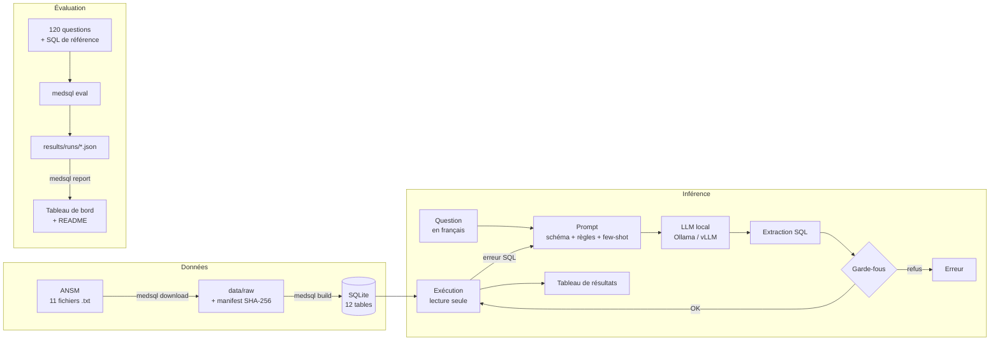

# Architecture

## Vue d'ensemble

## Modules

| Module | Rôle |
|---|---|
| `medsql.data.schema` | Source unique de vérité : tables, colonnes, types, descriptions. Alimente la DDL, le prompt et `docs/data.md`. |
| `medsql.data.download` | Téléchargement avec reprise et repli d'URL, manifeste horodaté avec empreintes SHA-256. |
| `medsql.data.normalize` | Fonctions pures de nettoyage (dates, prix, taux, booléens, encodage). Testées unitairement. |
| `medsql.data.build_db` | Chargement atomique (fichier temporaire puis renommage), index, `ANALYZE`. |
| `medsql.sql_guard` | Validation sqlglot, connexion `mode=ro`, autorisateur, délai, plafond, fonction `sans_accents()`. |
| `medsql.llm` | Protocole `LLMClient` et deux implémentations HTTP (Ollama natif, API OpenAI). |
| `medsql.prompting` | Prompt système, exemples few-shot, message d'auto-correction. |
| `medsql.pipeline` | Orchestration question → SQL → résultat, avec boucle de réparation bornée. |
| `medsql.eval` | Jeu de questions, métriques, exécution du banc, agrégations. |
| `medsql.report` | Tableau de bord HTML autonome et tableau Markdown du README. |
| `medsql.cli` | Interface `medsql` (Typer + Rich). |
| `app/app.py` | Démo Gradio. |

## Choix de conception

**SQLite plutôt que PostgreSQL.** La BDPM pèse quelques dizaines de Mo : un fichier unique,
sans serveur, se reconstruit en quelques secondes et s'embarque dans l'image Docker de la démo.

**Schéma complet dans le prompt.** Avec 12 tables (~4 000 tokens), la sélection de tables par
recherche sémantique fait plus de mal que de bien : elle rate des jointures. Le préfixe du prompt
est identique d'une question à l'autre, Ollama et vLLM le gardent en cache.

**`sans_accents()` côté SQL.** SQLite ne gère la casse que pour l'ASCII : `'é' LIKE 'É'` est faux,
et la BDPM écrit `PARACÉTAMOL`. Plutôt que d'espérer que le modèle devine l'orthographe exacte,
on expose une fonction déterministe et on l'impose dans les règles du prompt.

**Défense en profondeur.** Le SQL vient d'un modèle probabiliste : il est traité comme une entrée
utilisateur non fiable. Chaque barrière suffit seule à empêcher une écriture ; les tests vérifient
la connexion en lecture seule *sans* passer par le validateur.

**Clients HTTP minces plutôt que LangChain.** Deux classes de 40 lignes, testées avec
`httpx.MockTransport`, sans dépendance lourde ni abstraction à apprendre. Le même code mesure
Ollama et vLLM, ce qui prépare le banc d'inférence comparatif.
