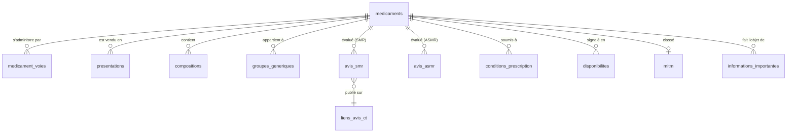

# Dictionnaire de données

> Fichier généré par `medsql docs` à partir de `src/medsql/data/schema.py`. Ne pas éditer à la main.

Source : [Base de données publique des médicaments](https://base-donnees-publique.medicaments.gouv.fr/telechargement)
(ANSM, HAS, Assurance maladie), mise à jour mensuelle, réutilisation libre.

## Modèle relationnel

## Transformations appliquées

| Donnée brute | Valeur en base |
|---|---|
| Encodage Windows-1252 ou UTF-8 | UTF-8 |
| Dates `JJ/MM/AAAA`, `AAAAMMJJ`, `AAAA-MM-JJ` | ISO `AAAA-MM-JJ` |
| Prix `1,086,58` ou `2,18` | `1086.58`, `2.18` (REAL, euros) |
| Taux `65%`, `65 %` | `65` (INTEGER) |
| `oui` / `non`, `Oui` / `Non` | `1` / `0` |
| Voies `orale;sublinguale` | colonne d'origine + table `medicament_voies` |
| Espaces parasites, champs vides | supprimés, `NULL` |

## `medicaments`

Une ligne par spécialité pharmaceutique (code CIS).  
Fichier source : `CIS_bdpm.txt`

| Colonne | Type | Description |
|---|---|---|
| `cis` 🔑 | INTEGER | Code CIS, identifiant de la spécialité |
| `denomination` | TEXT | Nom complet, ex. 'DOLIPRANE 1000 mg, comprimé' |
| `forme_pharmaceutique` | TEXT | ex. 'comprimé pelliculé', 'sirop' |
| `voies_administration` | TEXT | Voies séparées par ';' (voir medicament_voies) |
| `statut_amm` | TEXT | ex. 'Autorisation active', 'Autorisation abrogée' |
| `type_procedure_amm` | TEXT | ex. 'Procédure nationale', 'Procédure centralisée' |
| `etat_commercialisation` | TEXT | 'Commercialisée' ou 'Non commercialisée' |
| `date_amm` | DATE | Date d'AMM au format ISO 'AAAA-MM-JJ' |
| `statut_bdm` | TEXT | 'Alerte', 'Warning disponibilité' ou NULL |
| `numero_autorisation_europeenne` | TEXT | Numéro EU, NULL si national |
| `titulaires` | TEXT | Laboratoire(s) titulaire(s) de l'AMM, en majuscules |
| `surveillance_renforcee` | INTEGER | 1 si surveillance renforcée (triangle noir) |

## `medicament_voies`

Voies d'administration éclatées : une ligne par (spécialité, voie).  
Fichier source : `CIS_bdpm.txt`

| Colonne | Type | Description |
|---|---|---|
| `cis` 🔑 | INTEGER | Code CIS → `medicaments(cis)` |
| `voie` 🔑 | TEXT | ex. 'orale', 'cutanée', 'intraveineuse' |

## `presentations`

Boîtes vendues (présentations), avec prix et remboursement.  
Fichier source : `CIS_CIP_bdpm.txt`

| Colonne | Type | Description |
|---|---|---|
| `cip13` 🔑 | TEXT | Code CIP13 de la boîte |
| `cip7` | TEXT | Ancien code CIP7 |
| `cis` | INTEGER | Code CIS → `medicaments(cis)` |
| `libelle` | TEXT | ex. 'plaquette(s) PVC aluminium de 8 comprimé(s)' |
| `statut_administratif` | TEXT | ex. 'Présentation active' |
| `etat_commercialisation` | TEXT | ex. 'Déclaration de commercialisation' |
| `date_declaration` | DATE | Date de déclaration de commercialisation (ISO) |
| `agrement_collectivites` | INTEGER | 1 si agréé aux collectivités |
| `taux_remboursement` | INTEGER | Taux en pourcentage (15, 30, 65, 100), NULL sinon |
| `prix_euros` | REAL | Prix hors honoraires de dispensation, en euros |
| `prix_ttc_euros` | REAL | Prix honoraires de dispensation inclus, en euros |
| `honoraires_euros` | REAL | Honoraires de dispensation, en euros |
| `indications_remboursement` | TEXT | Texte des indications remboursables |

## `compositions`

Composition qualitative et quantitative : substances par spécialité.  
Fichier source : `CIS_COMPO_bdpm.txt`

| Colonne | Type | Description |
|---|---|---|
| `cis` | INTEGER | Code CIS → `medicaments(cis)` |
| `element_pharmaceutique` | TEXT | ex. 'comprimé', 'solution' |
| `code_substance` | INTEGER | Code de la substance |
| `substance` | TEXT | Nom de la substance en majuscules, ex. 'PARACÉTAMOL' |
| `dosage` | TEXT | ex. '1000 mg' |
| `reference_dosage` | TEXT | ex. 'un comprimé' |
| `nature_composant` | TEXT | 'SA' = substance active, 'FT' = fraction thérapeutique |
| `numero_liaison` | INTEGER | Lien entre une SA et sa FT |

## `groupes_generiques`

Groupes génériques : princeps et génériques substituables.  
Fichier source : `CIS_GENER_bdpm.txt`

| Colonne | Type | Description |
|---|---|---|
| `id_groupe` | INTEGER | Identifiant du groupe générique |
| `libelle_groupe` | TEXT | Libellé du groupe (substance, dosage, forme) |
| `cis` | INTEGER | Code CIS → `medicaments(cis)` |
| `type_generique` | INTEGER | 0=princeps, 1=générique, 2=complémentarité, 4=substituable |
| `type_libelle` | TEXT | 'princeps', 'générique', 'génériques par complémentarité posologique' ou 'générique substituable' |
| `numero_tri` | INTEGER | Ordre d'affichage dans le groupe |

## `avis_smr`

Avis de la HAS sur le Service Médical Rendu (SMR).  
Fichier source : `CIS_HAS_SMR_bdpm.txt`

| Colonne | Type | Description |
|---|---|---|
| `cis` | INTEGER | Code CIS → `medicaments(cis)` |
| `code_dossier_has` | TEXT | Code du dossier HAS |
| `motif_evaluation` | TEXT | ex. 'Inscription (CT)', 'Renouvellement d''inscription (CT)' |
| `date_avis` | DATE | Date de l'avis de la commission de la transparence (ISO) |
| `valeur_smr` | TEXT | 'Important', 'Modéré', 'Faible', 'Insuffisant', 'Non précisé' |
| `libelle_smr` | TEXT | Texte de l'avis |

## `avis_asmr`

Avis de la HAS sur l'Amélioration du Service Médical Rendu (ASMR).  
Fichier source : `CIS_HAS_ASMR_bdpm.txt`

| Colonne | Type | Description |
|---|---|---|
| `cis` | INTEGER | Code CIS → `medicaments(cis)` |
| `code_dossier_has` | TEXT | Code du dossier HAS |
| `motif_evaluation` | TEXT | Motif de l'évaluation |
| `date_avis` | DATE | Date de l'avis (ISO) |
| `valeur_asmr` | TEXT | 'I' (majeure) à 'V' (absence), ou 'Commentaires' |
| `libelle_asmr` | TEXT | Texte de l'avis |

## `conditions_prescription`

Conditions de prescription et de délivrance.  
Fichier source : `CIS_CPD_bdpm.txt`

| Colonne | Type | Description |
|---|---|---|
| `cis` | INTEGER | Code CIS → `medicaments(cis)` |
| `condition` | TEXT | ex. 'liste I', 'liste II', 'prescription hospitalière' |

## `disponibilites`

Ruptures et tensions d'approvisionnement déclarées.  
Fichier source : `CIS_CIP_Dispo_Spec.txt`

| Colonne | Type | Description |
|---|---|---|
| `cis` | INTEGER | Code CIS → `medicaments(cis)` |
| `cip13` | TEXT | Code CIP13, NULL si toutes les présentations |
| `code_statut` | INTEGER | 1=rupture, 2=tension, 3=arrêt de commercialisation, 4=remise à disposition |
| `statut` | TEXT | Libellé du statut |
| `date_debut` | DATE | Date de début (ISO) |
| `date_mise_a_jour` | DATE | Date de mise à jour (ISO) |
| `date_remise_disposition` | DATE | Date de remise à disposition (ISO), NULL sinon |
| `lien` | TEXT | Lien vers le site de l'ANSM |

## `mitm`

Médicaments d'intérêt thérapeutique majeur (MITM) avec code ATC.  
Fichier source : `CIS_MITM.txt`

| Colonne | Type | Description |
|---|---|---|
| `cis` | INTEGER | Code CIS → `medicaments(cis)` |
| `code_atc` | TEXT | Code ATC, ex. 'N02BE01' (paracétamol) |
| `denomination` | TEXT | Dénomination de la spécialité |
| `lien` | TEXT | Lien vers la fiche BDPM |

## `informations_importantes`

Informations de sécurité importantes publiées par l'ANSM.  
Fichier source : `CIS_InfoImportantes.txt`

| Colonne | Type | Description |
|---|---|---|
| `cis` | INTEGER | Code CIS → `medicaments(cis)` |
| `date_debut` | DATE | Début de l'information (ISO) |
| `date_fin` | DATE | Fin de l'information (ISO) |
| `texte` | TEXT | Texte et lien de l'information |

## `liens_avis_ct`

Liens vers les avis de la commission de la transparence de la HAS.  
Fichier source : `HAS_LiensPageCT_bdpm.txt`

| Colonne | Type | Description |
|---|---|---|
| `code_dossier_has` 🔑 | TEXT | Code du dossier HAS (cf. avis_smr, avis_asmr) |
| `lien` | TEXT | URL de l'avis sur le site de la HAS |
